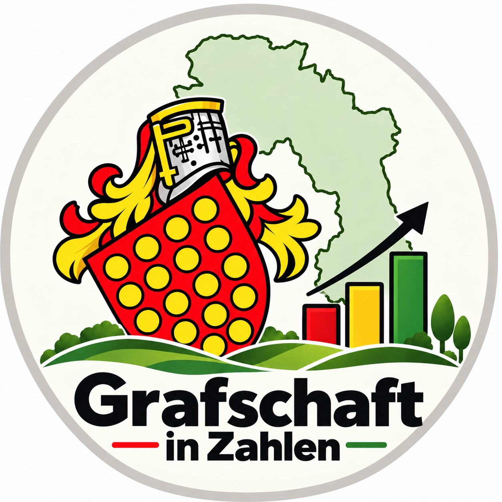

::: {.hero-giz}

::: {.hero-logo}
{width=230px}
:::

::: {.hero-text}

# Grafschaft in Zahlen

## Facts and figures from Grafschaft Bentheim

**Grafschaft in Zahlen** presents statistical data on the Grafschaft Bentheim district and its municipalities in a clear, transparent and accessible way.
The focus is on long-term trends, regional differences and interactive visualisations.

:::

:::


## The population of Grafschaft Bentheim in 2025 {.start-bevoelkerung-title}

::: {.start-bevoelkerung-chart}

```{r}
#| label: start-bevoelkerungspyramide
#| echo: false
#| warning: false
#| message: false

library(readr)
library(dplyr)
library(plotly)
library(htmlwidgets)
library(scales)


# ------------------------------------------------------------
# Read data
# ------------------------------------------------------------

bev_alter_start <- read_csv2(
  "../data/bev_alter_sex.csv",
  col_types = cols(
    gebietscode = col_character(),
    gebiet = col_character(),
    gebietstyp = col_character(),
    geschlecht = col_character(),
    altersgruppe = col_character(),
    altersgruppen_typ = col_character(),
    alter_von = col_double(),
    alter_bis_unter = col_double(),
    jahr = col_integer(),
    anzahl = col_double()
  ),
  show_col_types = FALSE
)


# ------------------------------------------------------------
# Grafschaft Bentheim district, 2025
# ------------------------------------------------------------

bev_pyramide_lang <- bev_alter_start |>
  filter(
    gebiet == "Grafschaft Bentheim",
    gebietstyp == "Landkreis",
    jahr == 2025,
    altersgruppen_typ == "Detail",
    !is.na(alter_von)
  ) |>
  mutate(
    altersgruppe_5j = case_when(
      alter_von >= 85 ~ "85+",
      TRUE ~ paste0(
        floor(alter_von / 5) * 5,
        "-",
        floor(alter_von / 5) * 5 + 4
      )
    )
  ) |>
  group_by(
    altersgruppe_5j,
    geschlecht
  ) |>
  summarise(
    anzahl = sum(
      anzahl,
      na.rm = TRUE
    ),
    .groups = "drop"
  )


# ------------------------------------------------------------
# Age-group order
# ------------------------------------------------------------

altersreihenfolge <- c(
  "0-4",
  "5-9",
  "10-14",
  "15-19",
  "20-24",
  "25-29",
  "30-34",
  "35-39",
  "40-44",
  "45-49",
  "50-54",
  "55-59",
  "60-64",
  "65-69",
  "70-74",
  "75-79",
  "80-84",
  "85+"
)


# ------------------------------------------------------------
# Combine male and female data
# ------------------------------------------------------------

pyramide_maenner <- bev_pyramide_lang |>
  filter(
    geschlecht == "Männlich"
  ) |>
  transmute(
    altersgruppe_5j,
    maenner = anzahl
  )


pyramide_frauen <- bev_pyramide_lang |>
  filter(
    geschlecht == "Weiblich"
  ) |>
  transmute(
    altersgruppe_5j,
    frauen = anzahl
  )


pyramide <- full_join(
  pyramide_maenner,
  pyramide_frauen,
  by = "altersgruppe_5j"
) |>
  mutate(
    gesamt = maenner + frauen,
    altersgruppe_5j = factor(
      altersgruppe_5j,
      levels = altersreihenfolge
    )
  ) |>
  arrange(
    altersgruppe_5j
  )


# ------------------------------------------------------------
# English number formatting
# ------------------------------------------------------------

format_anzahl <- function(x) {
  scales::number(
    x,
    accuracy = 1,
    big.mark = ",",
    decimal.mark = "."
  )
}


# ------------------------------------------------------------
# Hover/touch text
# ------------------------------------------------------------

pyramide <- pyramide |>
  mutate(
    hover_text = paste0(
      "<b>",
      as.character(altersgruppe_5j),
      "</b>",
      "<br><br>",
      "Population (Male): ",
      format_anzahl(maenner),
      "<br>",
      "Population (Female): ",
      format_anzahl(frauen),
      "<br>",
      "Population (Total): ",
      format_anzahl(gesamt)
    )
  )


# ------------------------------------------------------------
# Symmetric x-axis
# ------------------------------------------------------------

achsen_max <- 8000

x_ticks_desktop <- c(
  -8000,
  -4000,
  0,
  4000,
  8000
)

x_ticktexte_desktop <- c(
  "8,000",
  "4,000",
  "-",
  "4,000",
  "8,000"
)

x_ticks_mobil <- c(
  -8000,
  0,
  8000
)

x_ticktexte_mobil <- c(
  "8,000",
  "-",
  "8,000"
)


# ------------------------------------------------------------
# Plotly population pyramid
# ------------------------------------------------------------

p_bev_start <- plot_ly() |>

  # Male on the left
  add_bars(
    data = pyramide,
    y = ~altersgruppe_5j,
    x = ~-maenner,
    orientation = "h",
    name = "Male",
    marker = list(
      color = "#073B70"
    ),
    width = 0.82,
    hovertext = ~hover_text,
    hovertemplate = "%{hovertext}<extra></extra>"
  ) |>

  # Female on the right
  add_bars(
    data = pyramide,
    y = ~altersgruppe_5j,
    x = ~frauen,
    orientation = "h",
    name = "Female",
    marker = list(
      color = "#D70A53"
    ),
    width = 0.82,
    hovertext = ~hover_text,
    hovertemplate = "%{hovertext}<extra></extra>"
  ) |>

  layout(
    barmode = "overlay",
    bargap = 0.10,
    height = 555,
    showlegend = TRUE,
    hovermode = "closest",
    hoverdistance = 50,
    dragmode = FALSE,

    font = list(
      family = "Arial, sans-serif",
      color = "#222222"
    ),

    legend = list(
      orientation = "h",
      x = 0.5,
      y = 1.035,
      xanchor = "center",
      yanchor = "bottom",
      font = list(
        size = 16
      ),
      traceorder = "normal"
    ),

    xaxis = list(
      title = "",
      range = c(
        -achsen_max,
        achsen_max
      ),
      tickmode = "array",
      tickvals = x_ticks_desktop,
      ticktext = x_ticktexte_desktop,
      tickfont = list(
        size = 13,
        color = "#666666"
      ),
      showgrid = TRUE,
      gridcolor = "#D4D4D4",
      gridwidth = 1,
      zeroline = TRUE,
      zerolinecolor = "#202020",
      zerolinewidth = 1.35,
      showline = TRUE,
      linecolor = "#777777",
      linewidth = 1.15,
      ticks = "",
      automargin = TRUE,
      fixedrange = TRUE
    ),

    yaxis = list(
      title = "",
      categoryorder = "array",
      categoryarray = altersreihenfolge,
      tickfont = list(
        size = 14,
        color = "#666666"
      ),
      showgrid = FALSE,
      showline = TRUE,
      linecolor = "#777777",
      linewidth = 1.15,
      ticks = "",
      automargin = TRUE,
      fixedrange = TRUE
    ),

    margin = list(
      l = 94,
      r = 30,
      t = 54,
      b = 30
    ),

    plot_bgcolor = "#FFFFFF",
    paper_bgcolor = "#FFFFFF",

    hoverlabel = list(
      bgcolor = "#000000",
      bordercolor = "#000000",
      font = list(
        color = "#FFFFFF",
        size = 14
      ),
      align = "left"
    )
  ) |>

  config(
    displayModeBar = FALSE,
    responsive = TRUE,
    scrollZoom = FALSE,
    doubleClick = FALSE
  )


# ------------------------------------------------------------
# Interaction and smartphone layout
#
# Tooltip uses Plotly's native hover detection.
# On mobile devices the same information opens on tap.
# ------------------------------------------------------------

p_bev_start <- htmlwidgets::onRender(
  p_bev_start,
  "
  function(el, x) {

    function isMobile() {
      return window.innerWidth <= 600;
    }


    /*
      No Plotly.restyle on hover:
      This allows Plotly to display the tooltip immediately
      and reliably without an additional redraw.
    */

    el.on(
      'plotly_click',
      function(eventData) {

        if (
          !isMobile() ||
          !eventData.points ||
          !eventData.points.length
        ) {
          return;
        }

        var point =
          eventData.points[0];

        if (
          point.curveNumber === 0 ||
          point.curveNumber === 1
        ) {

          Plotly.Fx.hover(
            el,
            [
              {
                curveNumber: point.curveNumber,
                pointNumber: point.pointNumber
              }
            ]
          );
        }
      }
    );


    function responsivePyramid() {

      var mobile =
        isMobile();

      Plotly.relayout(
        el,
        {
          'height':
            mobile ? 500 : 555,

          'margin.l':
            mobile ? 58 : 94,

          'margin.r':
            mobile ? 8 : 30,

          'margin.t':
            mobile ? 43 : 54,

          'margin.b':
            mobile ? 32 : 30,

          'yaxis.tickfont.size':
            mobile ? 10.5 : 14,

          'xaxis.tickfont.size':
            mobile ? 9.5 : 13,

          'xaxis.tickvals':
            mobile ? [-8000, 0, 8000] : [-8000, -4000, 0, 4000, 8000],

          'xaxis.ticktext':
            mobile ? ['8,000', '-', '8,000'] : ['8,000', '4,000', '-', '4,000', '8,000'],

          'legend.font.size':
            mobile ? 12 : 16,

          'legend.y':
            mobile ? 1.025 : 1.035,

          'hoverlabel.font.size':
            mobile ? 11.5 : 14
        }
      );

      Plotly.Plots.resize(el);
    }


    responsivePyramid();

    window.addEventListener(
      'resize',
      responsivePyramid
    );
  }
  "
)


p_bev_start
```

:::

::: {.start-bevoelkerung-hinweis}

**Source:** Lower Saxony State Office for Statistics (LSN), population as of 31 December 2025.

:::

## Latest

Here you can find the latest post.

::: {#aktuelle-news}
:::

[**View all posts →**](news.qmd)


## Explore the data

```{=html}
<div class="themen-grid">

  <a id="thema-bevoelkerung"
     class="themen-kachel"
     href="bevoelkerung.html">

    <div class="themen-icon">
      <i class="bi bi-people-fill"></i>
    </div>

    <div class="themen-titel">
      Population
    </div>

    <div class="themen-text">
      Population trends, age structure and differences between the 25 municipalities.
    </div>

  </a>


  <a id="thema-gesundheit"
     class="themen-kachel"
     href="gesundheit.html">

    <div class="themen-icon themen-icon-gesundheit">
      <i class="bi bi-heart-pulse-fill"></i>
    </div>

    <div class="themen-titel">
      Health
    </div>

    <div class="themen-text">
      Health data, diseases and regional differences across Grafschaft Bentheim.
    </div>

  </a>


  <a id="thema-landwirtschaft"
     class="themen-kachel"
     href="landwirtschaft.html">

    <div class="themen-icon themen-icon-landwirtschaft">
      <span aria-hidden="true">🌾</span>
    </div>

    <div class="themen-titel">
      Agriculture
    </div>

    <div class="themen-text">
      Livestock farming, agricultural structures and interesting comparisons between the municipalities.
    </div>

  </a>

</div>

<div class="themen-hinweis">
  More topics will be added gradually.
</div>
```


## Grafschaft in Zahlen on Instagram

```{=html}
<div class="instagram-box">

  <div class="instagram-icon">
    <i class="bi bi-instagram"></i>
  </div>

  <div class="instagram-inhalt">

    <div class="instagram-titel">
      @grafschaftinzahlen
    </div>

    <div class="instagram-text">
      New visualisations, interesting figures and current developments from
      Grafschaft Bentheim are also available on Instagram.
    </div>

    <a
      class="instagram-button"
      href="https://www.instagram.com/grafschaftinzahlen/"
      target="_blank"
      rel="noopener noreferrer">
      <i class="bi bi-instagram"></i>
      Follow on Instagram
    </a>

  </div>

</div>
```


## [About the project](about.qmd)

**Grafschaft in Zahlen** is an independent statistics project.
Its aim is to present figures on Grafschaft Bentheim in an accessible way and to make developments at district and municipal level visible.