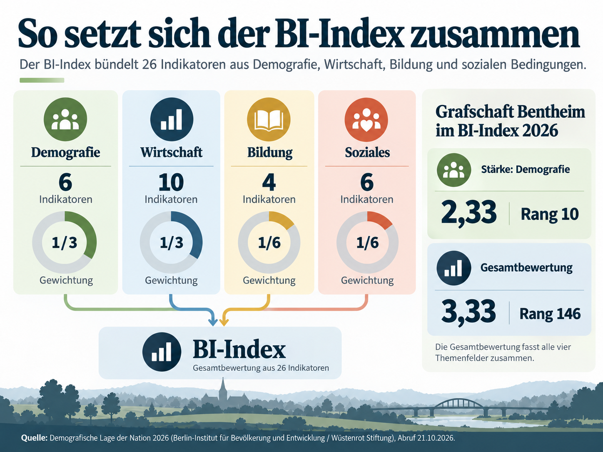
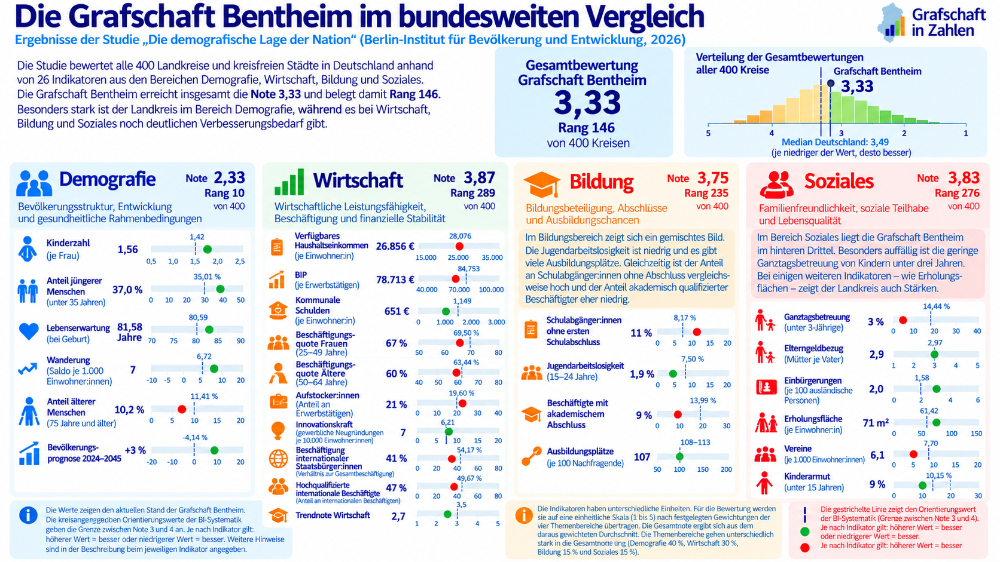
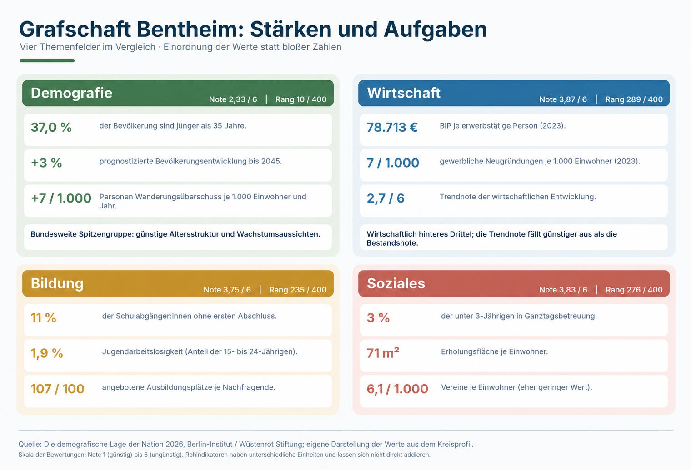

```{=html}
<style>
.article-demografie h2 {
  color: #073B70;
  margin-top: 2.2rem;
}

.article-demografie figure {
  margin-top: 1.5rem;
  margin-bottom: 2rem;
}

.article-demografie figure img {
  display: block;
  max-width: 100%;
  height: auto;
  margin-left: auto;
  margin-right: auto;
}

.article-demografie figcaption {
  color: #666666;
  font-size: 0.9rem;
  line-height: 1.4;
  text-align: left;
}

.article-demografie .studien-link {
  margin-top: 1.6rem;
  padding: 1rem 1.15rem;
  border-left: 4px solid #073B70;
  background: #f5f8fb;
}

.article-demografie .quelle-artikel {
  margin-top: 1.8rem;
  color: #5f5f5f;
  font-size: 0.9rem;
  line-height: 1.5;
}
</style>
```

::::: article-demografie
Die Grafschaft Bentheim gehört bei der demografischen Entwicklung zu den zehn bestplatzierten Regionen Deutschlands. In anderen Bereichen zeigt sich jedoch Nachholbedarf. Das geht aus der im Oktober 2026 veröffentlichten Studie **„Die demografische Lage der Nation“** hervor.

Das Berlin-Institut für Bevölkerung und Entwicklung und die Wüstenrot Stiftung haben die Zukunftsfähigkeit aller 400 deutschen Landkreise und kreisfreien Städte anhand von 26 Indikatoren aus den Bereichen Demografie, Wirtschaft, Bildung und Soziales untersucht. Die Grafschaft Bentheim erreicht dabei mit der **Gesamtnote 3,33 den bundesweiten Rang 146** und schneidet damit etwas besser ab als der Median aller untersuchten Regionen (3,49).

{fig-alt="Zusammensetzung des BI-Index 2026 aus Demografie, Wirtschaft, Bildung und Sozialem" width="88%"}

## Demografie: Grafschaft gehört zur bundesweiten Spitzengruppe

Mit der **Note 2,33 und Rang 10** gehört die Grafschaft Bentheim im Bereich Demografie zu den bestplatzierten Regionen Deutschlands. Der Landkreis teilt sich diesen Rang mit zwölf weiteren Kreisen. Die vergleichsweise junge Bevölkerungsstruktur trägt wesentlich zum guten Abschneiden bei: 37,0 % der Bevölkerung sind jünger als 35 Jahre, während lediglich 10,2 % älter als 74 Jahre sind. Die durchschnittliche Kinderzahl liegt bei 1,56 je Frau, die Lebenserwartung bei 81,58 Jahren. Zudem profitiert der Landkreis von Wanderungsgewinnen. Besonders positiv fällt die Bevölkerungsprognose aus: Bis 2045 wird ein Bevölkerungswachstum von rund 3 % erwartet, während Niedersachsen insgesamt voraussichtlich etwa 2,5 % seiner Bevölkerung verlieren wird.

{fig-alt="Infografik zur Grafschaft Bentheim im bundesweiten Vergleich des BI-Index 2026" width="100%"}

## Wirtschaft: Schwächen trotz vergleichsweise günstiger Entwicklung

Im Bereich Wirtschaft schneidet die Grafschaft Bentheim deutlich schwächer ab als bei der Demografie. Mit der **Note 3,87 und Rang 289 von 400** liegt der Landkreis im hinteren Drittel des bundesweiten Vergleichs. Mehrere Einzelindikatoren bewegen sich dabei im Mittelfeld: Das verfügbare Haushaltseinkommen beträgt **26.856 Euro je Einwohner**, das Bruttoinlandsprodukt **78.713 Euro je Erwerbstätigen** und die kommunale Verschuldung **651 Euro je Einwohner**.

Besonders ungünstig fällt jedoch die **Arbeitsmarktintegration ausländischer Staatsangehöriger** aus. Deren Beschäftigungsquote erreicht in der Grafschaft nur rund **41 % der allgemeinen Beschäftigungsquote**. Im Bewertungssystem des BI-Index entspricht dies der schlechtesten Notenstufe. Auch die Beschäftigungsquoten von **Frauen mit rund 67 %** und von **50- bis 64-Jährigen mit rund 60 %** liegen trotz auf den ersten Blick vergleichsweise hoher Werte lediglich im mittleren Bewertungsbereich.

Positiv ist dagegen die Entwicklung der vergangenen Jahre: Die **wirtschaftliche Trendnote von 2,7** fällt deutlich günstiger aus als die aktuelle Wirtschaftsbewertung. Dies deutet darauf hin, dass sich mehrere wirtschaftliche Kennzahlen zuletzt vergleichsweise positiv entwickelt haben, auch wenn die Grafschaft beim derzeitigen Niveau weiterhin hinter vielen anderen Regionen zurückliegt.

## Bildung: Gute Ausbildungschancen, aber Defizite bei Schulabschlüssen

Im Themenfeld Bildung erreicht die Grafschaft Bentheim die **Note 3,75 und Rang 235**. Auffällig ist insbesondere der Anteil von 11 % der Schulabgängerinnen und Schulabgänger ohne ersten Schulabschluss. Auch der Anteil akademisch qualifizierter Beschäftigter fällt mit 9 % vergleichsweise niedrig aus. Positiver gestaltet sich dagegen der Übergang in den Arbeitsmarkt: Die Jugendarbeitslosigkeit liegt bei lediglich 1,9 %. Mit 107 angebotenen betrieblichen Ausbildungsplätzen je 100 Nachfragenden verfügt die Grafschaft zudem über ein relativ ausgewogenes Ausbildungsangebot. Insgesamt ergibt sich ein gemischtes Bild mit Stärken in der beruflichen Ausbildung und Verbesserungspotenzial bei schulischen Abschlüssen.

## Soziales: Besonders großer Nachholbedarf bei der Kinderbetreuung

Mit der **Note 3,83 und Rang 276** zählt auch der Bereich Soziales und Familienfreundlichkeit zu den schwächer bewerteten Themenfeldern. Besonders auffällig ist die geringe Ganztagsbetreuungsquote: Nur etwa 3 % der Kinder unter drei Jahren werden ganztägig in einer Kindertageseinrichtung betreut. Beim Elterngeldbezug kommen rund 2,9 Mütter auf einen Vater. Die Kinderarmutsquote liegt bei etwa 9 %, die Einbürgerungsquote bei 2 %. Mit 71 Quadratmetern Erholungsfläche je Einwohner und 6,1 Vereinen je 1.000 Einwohner zeigt sich bei weiteren sozialen Rahmenbedingungen ein gemischtes Bild. Insgesamt besteht insbesondere bei der frühkindlichen Betreuung deutlicher Verbesserungsbedarf.

{fig-alt="Zusammenfassung der Stärken und Aufgaben der Grafschaft Bentheim in Demografie, Wirtschaft, Bildung und Sozialem" width="96%"}

## Fazit: Demografischer Vorsprung, aber nicht in allen Bereichen zukunftsfest

Die Grafschaft Bentheim verfügt über ausgesprochen günstige demografische Voraussetzungen und dürfte entgegen dem allgemeinen Trend in Niedersachsen auch in den kommenden Jahren weiter wachsen. Dieser Vorteil spiegelt sich jedoch bislang nicht gleichermaßen in den wirtschaftlichen, bildungsbezogenen und sozialen Rahmenbedingungen wider. Besonders in der Kinderbetreuung, bei schulischen Abschlüssen und der Arbeitsmarktintegration bestehen wichtige Ansatzpunkte, um die Zukunftsfähigkeit des Landkreises langfristig zu stärken.

::: studien-link
**Zur vollständigen Studie und zum interaktiven Online-Tool:**\
[demografischelage.de](https://demografischelage.de/){target="_blank" rel="noopener noreferrer"}
:::

::: quelle-artikel
**Quelle:** Berlin-Institut für Bevölkerung und Entwicklung und Wüstenrot Stiftung (2026): *Die demografische Lage der Nation – Wie zukunftsfähig Deutschlands Regionen in Zeiten des Strukturwandels sind.* Insbesondere S. 65–67 und 99–105 sowie die ergänzenden regionalen Indikatoren unter [demografischelage.de](https://demografischelage.de/).
:::
:::::
